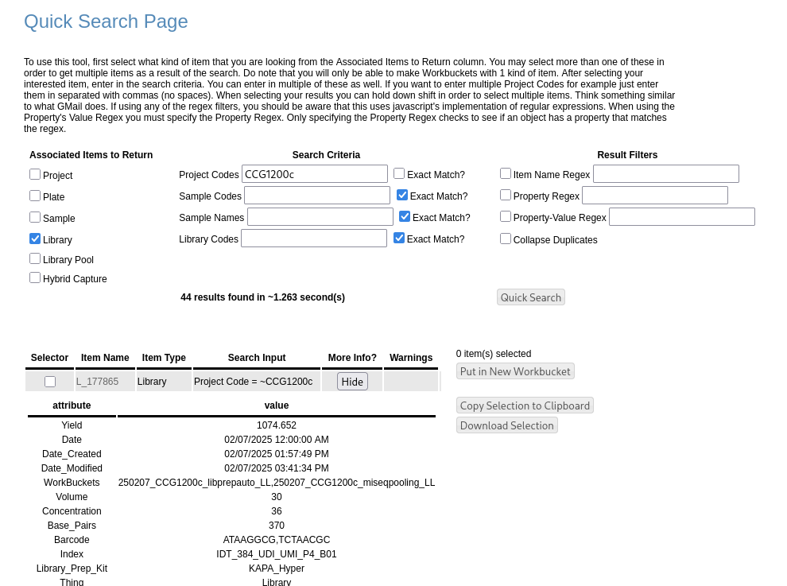

# Setup for Sarek Run
Directions on how to create Sarek Samplesheet and then rename fastqs.

## Basic Samplesheet Creation
1. If your project is in MiniLIMS, this is straightforward. Run the following command:

## Rename Fastqs


## Edge Cases
### Manually Creating the Samplesheet
An example of a samplesheet is as follows
(as described in [Sarek docs](https://nf-co.re/sarek/3.7.1/docs/usage/)). The patient an id for the individual/organism.
The status is 0 for normal and 1 for tumor. The sample is the same name. The lane is the lane on the instrument. If
you have multiple lanes for 1 sample, there will need to be multiple lines in the samplesheet for 1 sample with the
sample name repeating (each line has unique fastqs and lanes, however). The fastq_1 column is the R1 fastq.gz file,
and the fastq_2 is the R2 fastq.gz file.
```
patient,status,sample,lane,fastq_1,fastq_2
A001,1,A001_X101_49707-1-B1,L005,gs://ccg-bioinformatics/mnt/storage/centers/ccgd/nap24/pipeline_rnd/pipeline_sarek/demult_revcomp_0089/A001_X101_49707-1-B1_S14_R1_001.fastq.gz,gs://ccg-bioinformatics/mnt/storage/centers/ccgd/nap24/pipeline_rnd/pipeline_sarek/demult_revcomp_0089/A001_X101_49707-1-B1_S14_R2_001.fastq.gz
A008,1,A008_X108_58797-1-C1,L005,gs://ccg-bioinformatics/mnt/storage/centers/ccgd/nap24/pipeline_rnd/pipeline_sarek/demult_revcomp_0089/A008_X108_58797-1-C1_S13_R1_001.fastq.gz,gs://ccg-bioinformatics/mnt/storage/centers/ccgd/nap24/pipeline_rnd/pipeline_sarek/demult_revcomp_0089/A008_X108_58797-1-C1_S13_R2_001.fastq.gz
```
```bash
gcloud storage cp ${PROJECT_CODE}_sarek_samplesheet.csv gs://ccg-bioinformatics/mnt/storage/centers/ccgd/Illumina/pipeline_sarek/${PROJECT_CODE}/csv/
```
You can use Edwin's [Quick Search](https://ccgd2.dfci.harvard.edu/minilims/html/quick_search.php)
to match up the index/barcode with the MBCF fastq if the project is in LIMS.



However, if the sample names are not in LIMS, and is in some excel sheet somewhere, use your judgement on creating the
samplesheet.

## Troubleshooting
## File collisions
1. If you get an error that looks something like this:
```
Process `NFCORE_SAREK:SAREK:FASTQ_PREPROCESS_GATK:FASTP` input file name collision -- There are multiple input files
for each of the following file names: 49_10_KAPA3uM_14cyc_S29_L002_R1_001.fastq.gz
```
2. Double check there are no and you know there are not multiple files.
```bash
cd /mnt/storage/centers/ccgd/Illumina/pipeline_sarek/${PROJECT_CODE}/preprocessing/fastq
find . -name "*.fastq.gz" | xargs -n1 basename | sort | uniq -d
# should return empty if there are no duplicates.
```
3. Double check the same file is not specified twice.
4. Surround all strings with quotes in the csv. A shortcut:
```bash
# Open in Libreoffice > Save As > Select "Edit filter settings" > Select "Quote all text cells"
gcloud storage cp *.csv gs://ccg-bioinformatics/mnt/storage/centers/ccgd/Illumina/pipeline_sarek/${PROJECT_CODE}/csv/
```