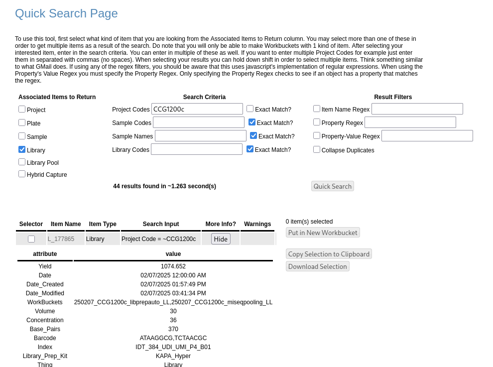

# Sarek Directions
These are directions for running the Sarek pipeline and it's reporting scripts.

Steps of running sarek are:
1. [Generate the Sarek Samplesheet](#1-generate-the-sarek-samplesheet)
2. [Run the sarek pipeline](#2-run-the-sarek-pipeline)
3. [Run somalier/Fingerprinting](#3-run-somalier--fingerprinting)
4. [Run reporting scripts](#4-run-the-reporting-scripts)

## 1. Generate the Sarek Samplesheet
An example of a samplesheet is as follows
(as described in [Sarek docs](https://nf-co.re/sarek/3.7.1/docs/usage/)). The patient an id for the individual/organism.
The status is 0 for normal and 1 for tumor. The sample is the same name. The lane is the lane on the instrument. If
you have multiple lanes for 1 sample, there will need to be multiple lines in the samplesheet for 1 sample with the
sample name repeating (each line has unique fastqs and lanes, however). The fastq_1 column is the R1 fastq.gz file,
and the fastq_2 is the R2 fastq.gz file.
```
patient,status,sample,lane,fastq_1,fastq_2
A001,1,A001_X101_49707-1-B1,L005,gs://ccg-bioinformatics/mnt/storage/centers/ccgd/nap24/pipeline_rnd/pipeline_sarek/demult_revcomp_0089/A001_X101_49707-1-B1_S14_R1_001.fastq.gz,gs://ccg-bioinformatics/mnt/storage/centers/ccgd/nap24/pipeline_rnd/pipeline_sarek/demult_revcomp_0089/A001_X101_49707-1-B1_S14_R2_001.fastq.gz
A008,1,A008_X108_58797-1-C1,L005,gs://ccg-bioinformatics/mnt/storage/centers/ccgd/nap24/pipeline_rnd/pipeline_sarek/demult_revcomp_0089/A008_X108_58797-1-C1_S13_R1_001.fastq.gz,gs://ccg-bioinformatics/mnt/storage/centers/ccgd/nap24/pipeline_rnd/pipeline_sarek/demult_revcomp_0089/A008_X108_58797-1-C1_S13_R2_001.fastq.gz
```

🚧 **Under construction.** 🚧 I'm hoping to create something like the python script created by Edwin to run the
Scaffron pipeline. For now, you can use Edwin's [Quick Search](https://ccgd2.dfci.harvard.edu/minilims/html/quick_search.php)
to match up the index/barcode with the MBCF fastq.



## 2. Run the Sarek pipeline
Please see the [run pipeline directions](./run_sarek_pipeline.md)

## 3. Run Somalier / Fingerprinting
Please see the [run somalier directions](./run_sarek_pipeline.md#run-somalierfingerprinting)

## 4. Run the reporting scripts
Please see the [run reporting scripts directions](./run_reporting.md)

## Edge Cases
### Regenerate Old Bait or Old PON
If you're running a bait set for the first time through Sarek, it's a good idea to generate a PON before the actual run
you need to do or at least generate the bed file.

#### Convert Riker .interval_list to Sarek .bed file
1. Sarek runs on .bed files (not GATK .interval_list files). Convert the interval list to a .bed file.
```bash
ssh argos-ccgd.dfci.harvard.edu
qrsh -pe pvm 3
cd /mnt/storage/centers/ccgd/nap24/baits
# The format for bait set names at CCG is the bait name next to the supplier id (e.g. supplier = Agilent, Twist, etc.)
BAIT_NAME=[bait_name_supplier_id]
mkdir ${BAIT_NAME}
cd /mnt/storage/centers/ccgd/reference_files/baits/GRCh37/${BAIT_NAME}
ls
less /mnt/storage/centers/ccgd/apps/Riker/latest/Riker.ccgd.clouddb.config
# pick the one that's used for full_targets in Riker
# (https://wiki.dfci.harvard.edu:8443/pages/viewpage.action?pageId=60738749)
mkdir /mnt/storage/centers/ccgd/nap24/baits/${BAIT_NAME}/
cp [the_baits.interval_list] /mnt/storage/centers/ccgd/nap24/baits/${BAIT_NAME}/
cd /mnt/storage/centers/ccgd/nap2q4/baits/${BAIT_NAME}/
```
2. Upload to gcloud.
```bash
gcloud storage cp ${BAIT_NAME}_$(date --iso-8601)Merged.bed gs://ccg-bioinformatics/mnt/storage/centers/ccgd/nap24/baits/${BAIT_NAME}/
```
3. Run the fix_bed tool. It does the following:
    * Converts the .interval_list to .bed
    * Sorts the chromosomes numerically.
    * Merges overlapping regions.
    * Annotates the regions in a way that CNVKit expects.
```bash
/opt/ccgd-rotation-suite/sarek_summary_reports/convert_to_sarek_bed.py -i [input.interval_list]
```
4. Add the .bed to Sarek config.
```bash
cp /opt/sarek/conf/ccg/grch37/baits/POPv3.1_S3050142.config /opt/sarek/conf/ccg/grch37/baits/${BAIT_NAME}.config
vim /opt/sarek/conf/ccg/grch37/baits/${BAIT_NAME}.config  # Change POPv3 beds to your new bed
# Delete the pon, pon_tbi, and cnvkit_reference if you don't have a PON, yet.
vim /opt/sarek/conf/ccg/ccg.config
# Add the bait set as a new profile. Note: periods (.) are not allowed in profile names in nextflow. I would
# use the same bait name next to the supplier id for the profile name though.
cp -r /opt/sarek/conf/ccg /opt/sarek-create-pon/conf/
```

#### Regenerate Old PON
2. Look on argos-ccgd for samples in the old PON.
```bash
ssh argos-ccgd.dfci.harvard.edu
cd /mnt/storage/centers/ccgd/bmw35/RobustCNV_PON
cd [YOUR PON]
cd coverage_and_calls
ls -tlh *.dedup.cleaned.txt
# Try to find files/samples in the last 5 years. Ideally, you find a instrument run that has a lot of normals so you
# don't have to do a lot of Sarek runs, either.
find . -name "*.dedup.cleaned.txt" -ctime -1825 \
    -exec sh -c "basename {} .dedup.cleaned.txt | sed -r 's/_L_[0-9]{6}//g' | sed 's/^\|$/\"/g'" \; | tr '\n' ', '
```
2. Query to find what instrument runs the samples were on.
```sql
SELECT rs.sample_collaborator_name, p.project_code, ir.run_name, pl.platform_location_description  
FROM received_sample rs
JOIN project p ON p.project_id = rs.project_id
JOIN illumina_lane_member ilm ON ilm.sample_id = rs.received_sample_id
JOIN flowcell_content fc ON fc.flowcell_content_id = ilm.flowcell_content_id
JOIN instrument_run ir ON ir.instrument_run_id = fc.instrument_run_id
JOIN platform_location pl ON pl.platform_location_id  = fc.platform_location_id 
WHERE rs.sample_collaborator_name IN ([FROM FIND COMMAND]);
```
3. Restore the old Riker runs and proceed to [rerun old riker project directions](#rerun-old-riker-project)
4. Proceed to [Generate PON](./run_sarek_pipeline.md#generate-pon)

### Rerun old Riker Project
If the project has never been run on the bait before, you will probably want to regenerate a PON or at least the .bed
file. See the directions [above](#regenerate-old-bait-or-old-pon)
1. Restore the old run to argos.
```bash
ssh rc-stor12.dfci.harvard.edu
cd /data/backups/mnt/storage/centers/ccgd/Illumina/Basecalls/
nohup rsync -r 200127_SN218_1093_BHCCKWBCX3 /mnt/storage/centers/ccgd/Illumina/Basecalls/ &> ~/log/rsync_restore_200127_SN218_1093_BHCCKWBCX3.txt &
```
2. Add the following line at the top of the bcl2fastq_samplesheet.csv:
```
[Data],,,
```
3. Run this query:
```sql
SELECT SUBSTRING_INDEX(pl.platform_location_description, "_", -1) AS Lane,
rec.sample_collaborator_name AS Sample_ID,
first_barcode.barcode_sequence AS `index`, second_barcode.barcode_sequence AS `index2`,
plat.second_index_direction
FROM project proj
JOIN received_sample rec ON proj.project_id  = rec.project_id 
JOIN illumina_lane_member ilm ON ilm.`sample_id` = rec.`received_sample_id`
JOIN flowcell_content fc ON fc.flowcell_content_id = ilm.flowcell_content_id 
JOIN instrument_run ir ON ir.instrument_run_id = fc.instrument_run_id 
JOIN platform_location pl ON fc.platform_location_id = pl.platform_location_id
JOIN platform plat ON plat.platform_id = pl.platform_id 
JOIN library lib ON lib.sample_id  = rec.received_sample_id  
JOIN seq_barcode_set_member bsm ON lib.barcode_set_member_id = bsm.`seq_barcode_set_member_id`
JOIN seq_barcode first_barcode ON first_barcode.seq_barcode_id = bsm.first_seq_barcode_id
JOIN seq_barcode second_barcode ON second_barcode.seq_barcode_id = bsm.second_seq_barcode_id
WHERE proj.project_code = "CCG1200c-Oncopanel"
ORDER BY pl.platform_location_description, rec.sample_collaborator_name ;
```
4. If the `second_index_direction` comes out as REVCOMP, please use https://reverse-complement.com/
   to find the reverse complement of index2. You can just copy and paste the column out of DBeaver. Rows should be
   seperated by new lines. The site will figure out what you mean.
5. Copy and paste Lane,Sample_ID,index,index2 into the bcl2fastq_samplesheet.csv below the `[Data],,,` line.
6. Make the output directory, and upload the samplesheet file to argos:
```bash
scp {project}_bcl2fast_samplesheet.csv argos-ccgd.dfci.harvard.edu:~/.
ssh argos-ccgd.dfci.harvard.edu
cd /mnt/storage/centers/ccgd/Illumina/pipeline_sarek/
PROJECT_CODE=[YOUR PROJECT CODE]
mkdir -p SE81226a-ULPWGS/csv SE81226a-ULPWGS/demultiplex
mv ~/${PROJECT_CODE}_bcl2fast_samplesheet.csv  SE81226a-ULPWGS/csv/
```
7. Run bcl2fastq on argos. Example commands:
```bash
screen
qrsh -pe pvm 16
/mnt/storage/centers/ccgd/apps/bcl2fastq/2.20.0.422/bin/bcl2fastq \
  --create-fastq-for-index-reads --no-lane-splitting --ignore-missing-positions --ignore-missing-controls \
  --ignore-missing-filter --ignore-missing-bcls -r 6 -w 6  \
  -R /mnt/storage/centers/ccgd/Illumina/Basecalls/20251226_LH00547_0191_A23FKMFLT3_JN13779-L001_EVB13781-L002_LL13786-L003_AN13788-L005 \
  --output-dir=/mnt/storage/centers/ccgd/Illumina/pipeline_sarek/SE81226a-ULPWGS/demultiplex \
  --interop-dir=/tmp \
  --sample-sheet=/mnt/storage/centers/ccgd/Illumina/pipeline_sarek/SE81226a-ULPWGS/csv/SE81226a_bcl2fast_samplesheet.csv
```
8. Upload to gcloud after done demultiplexing:
```bash
screen ls
screen -d -r [old session for demultiplexing]
gcloud storage cp -r /mnt/storage/centers/ccgd/Illumina/pipeline_sarek/${PROJECT_CODE} \
    gs://ccg-bioinformatics/mnt/storage/centers/ccgd/Illumina/pipeline_sarek/
```
9. Run the following to get the fastqs to add to the samplesheet:
```bash
# For fastq_1 column
gcloud storage ls "gs://ccg-bioinformatics/mnt/storage/centers/ccgd/Illumina/pipeline_sarek/${PROJECT_CODE}/demultiplex/*R1*"
# For fastq_2 column
gcloud storage ls "gs://ccg-bioinformatics/mnt/storage/centers/ccgd/Illumina/pipeline_sarek/${PROJECT_CODE}/demultiplex/*R2*"
```
10. Grab the other columns with a query.
    * **Nota bene:** You might only need to grab one lane if you used `--no-lane-splitting` on the demultiplexing step.
    * **Nota bene bis:** Status should be 1 for all normals if creating a PON. Normals should be treaded like tumor
      samples when run through Sarek (when creating a PON).
```sql
SELECT i.individual_collaborator_name as patient,
IF(rec.genomic_source_id=2, 0, 1) AS status,
rec.sample_collaborator_name AS sample,
SUBSTRING_INDEX(pl.platform_location_description, "_", -1) AS lane
FROM project proj
JOIN received_sample rec ON proj.project_id  = rec.project_id
JOIN individual i ON i.individual_id = rec.individual_id 
JOIN illumina_lane_member ilm ON ilm.`sample_id` = rec.`received_sample_id`
JOIN flowcell_content fc ON fc.flowcell_content_id = ilm.flowcell_content_id 
JOIN instrument_run ir ON ir.instrument_run_id = fc.instrument_run_id 
JOIN platform_location pl ON fc.platform_location_id = pl.platform_location_id
WHERE proj.project_code = "[Your project code]"
ORDER BY rec.sample_collaborator_name ;
```
11. Create a sarek_samplesheet.csv. See [above directions](#1-generate-the-sarek-samplesheet) for details.
12. Kickoff Sarek pipeline as in [run pipeline directions](./run_pipeline.md)
